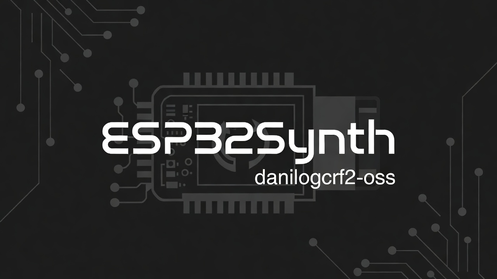

# ESP32Synth v2.6.1 — Bare-Metal Polyphonic Stereo DSP Engine & Multi-Core Streaming for ESP32

<p align="center">
  
</p>

<p align="center">
  
  
  
  
  
</p>

A bare-metal, polyphonic **True Stereo** synthesizer, multi-bus fixed-point DSP processor, and multi-core audio streaming engine for the Espressif ESP32 family (ESP32, ESP32-S3, ESP32-P4, ESP32-S2, ESP32-C3, ESP32-C6). Built for raw integer execution, ultra-low latency, extreme voice density, modular modulation routing, and multi-core streaming. Fully compatible with **Arduino IDE** and **PlatformIO** (both Arduino and native ESP-IDF).

### ✨ What's New in v2.6.1
* **True Stereo Synthesis & Smart Zero-Overhead Panning (`SYNTH_STEREO`)**: Full dual-channel audio pipeline across oscillators, wavetables, PCM samples (mono & stereo), streams, buses, FX, custom hooks, and SD recording. Centered and hard-panned voices automatically bypass stereo multipliers using dedicated fast-path center/L/R accumulators (`PAN_CENTER`, `PAN_HARD_L`, `PAN_HARD_R`, `PAN_STEREO`), preserving high polyphony while delivering full stereo width (`Mid/Side` processing from `0` to `512`), pan slides, per-voice Auto-Pan LFO, and 3 selectable Pan Laws (`PAN_LAW_CONSTANT_POWER`, `PAN_LAW_LINEAR`, `PAN_LAW_BALANCE`). Toggle `SYNTH_STEREO 0` in `ESP32Synth_Config.hpp` anytime for Classic Mono mode with maximum voice density and minimal RAM.
* **9 Built-In Fixed-Point Bus FX + Master Post-Mixdown FX Chain (`ESP32Synth_FX.hpp`)**: Expanded from 3 to **4 FX slots per bus (`MAX_FX_PER_BUS = 4`)**, and **Bus 0** now executes its own post-mixdown Master FX chain! Built-in zero-float effects include **Overdrive** (Soft/Tube/Fuzz), **Chorus**, **Flanger**, **Phaser** (2–8 stages), **Delay** (with pitch-slewed time modulation, ping-pong, damping, and PSRAM fallback), **Reverb** (4-comb Schroeder + 2 all-pass + width), **Biquad Filter** (Q28 TDF-II with cached coefficients), **Compressor**, and **Bitcrusher** — all with dedicated shortcut methods and full mono/stereo engines.
* **Modular LFO & Modulation Matrix (`ESP32Synth_LFO.hpp`)**: Up to **16 global LFOs (`MAX_LFOS`)** with 7 waveforms (`LFO_SINE`, `LFO_TRIANGLE`, `LFO_SAW_UP`, `LFO_SAW_DOWN`, `LFO_SQUARE` with variable duty cycle, `LFO_SAMPLE_HOLD`, `LFO_SMOOTH_RANDOM`), start phase, delay, fade-in, one-shot mode, retriggering, and user callbacks. Route up to **32 modulation slots (`MAX_LFO_ROUTES`)** across **15 targets** (Voice PW/CP/Pitch/Vol/Pan, Bus Mix/Pan/Width/FX Params, Global DSP Params, Master Vol/Pan/Width, and **LFO-to-LFO** Rate/Amp cross-modulation) using **Range Mode**, **Additive Depth Mode**, or stacked 2-pass modulation with automatic parameter restoration.
* **True Stereo Hardware Outputs & I2S MCLK Support**: Stereo support across **`beginDAC(pinL, pinR)`** (ESP32 / ESP32-S2 alternating channel mode), **`beginPWM(pinL, pinR)`** (dual-channel bare-metal LEDC ISR with dual-channel `armPWM`/`unArmPWM` thermal & click protection), **`beginPDM_DAC(pinL, pinR)`** (2-line hardware PDM DAC on supported chips like ESP32-S3), **`beginCustomStereo()`**, and optional **MCLK** pin initialization for I2S DACs/codecs (`begin(bck, ws, data, mclk, depth)`).
* **Studio-Quality Interpolated Sine LUT (`SYNTH_INTERPOLATE_SINE`)**: Uses a guard-padded 4096-entry LUT (`SINE_LUT_SIZE + 1`) for zero-branch linear interpolation (>130 dBc SFDR) on FM, overdrive, and sine oscillators, or toggle `SYNTH_INTERPOLATE_SINE 0` for maximum raw polyphony.
* **Stereo Samples, Stereo SD Recording & Expanded Telemetry**: `registerSample()` now supports stereo (`numChannels = 2`) in 4-bit, 8-bit, and 16-bit formats; `startRecording()` writes mono or stereo 16-bit WAV files; new getters expose real-time voice states (`getOutput8Bit`, `getEnv8Bit`, `getCPULoad`, `getStreamLoad`, `getStreamSampleRate`, `getStreamChannels`, `getStreamBitsPerSample`, and more); `setSmoothEnv()` enables click-free legato envelope transitions; and all `ESP32Patches` DSP/FX algorithms now support both Stereo and Mono seamlessly.

<p align="center">
  <a href="https://ko-fi.com/G3E323KDZC">
    
  </a>
  <br/>
  <i>plz 🙏🥺</i>
</p>

---

## 📖 Table of Contents

1. [Architectural Highlights & DSP Signal Flow](#1-architectural-highlights--dsp-signal-flow)
2. [Dual-Framework Setup (Arduino IDE & PlatformIO / ESP-IDF)](#2-dual-framework-setup-arduino-ide--platformio--esp-idf)
3. [Multi-Core Distribution: Core 0 vs Core 1](#3-multi-core-distribution-core-0-vs-core-1)
4. [Engine Configuration & Latency Tuning](#4-engine-configuration--latency-tuning)
5. [Memory Architecture & Hardware Alignment](#5-memory-architecture--hardware-alignment)
6. [Complete Core API Reference](#6-complete-core-api-reference)
7. [True Stereo Engine, Panning Laws & Stereo Width](#7-true-stereo-engine-panning-laws--stereo-width)
8. [Modular Bus Routing & Built-In Fixed-Point FX Engine](#8-modular-bus-routing--built-in-fixed-point-fx-engine)
9. [Modular LFO & Modulation Matrix](#9-modular-lfo--modulation-matrix)
10. [Hardware Output Modes (`SMODE`)](#10-hardware-output-modes-smode)
11. [PWM Thermal & Click Protection (CYD & Direct Speakers)](#11-pwm-thermal--click-protection-cyd--direct-speakers)
12. [SD Card & Flash Audio Streaming & Stereo WAV Recording](#12-sd-card--flash-audio-streaming--stereo-wav-recording)
13. [External Protocol Pull Mode & Custom Hooks (Bluetooth A2DP & Wi-Fi)](#13-external-protocol-pull-mode--custom-hooks-bluetooth-a2dp--wi-fi)
14. [Fixed-Point Advanced DSP & Patches (`ESP32Synth_Patches.hpp`)](#14-fixed-point-advanced-dsp--patches-esp32synth_patcheshpp)
15. [The FLT Engine (Float Translator & Fixed-Point Math)](#15-the-flt-engine-float-translator--fixed-point-math)
16. [Troubleshooting & Best Practices](#16-troubleshooting--best-practices)

---

## 1. Architectural Highlights & DSP Signal Flow

ESP32Synth delivers high polyphonic voice density (up to **340** voices on Classic ESP32 and up to **500** voices on ESP32-S3 at 240 MHz in Classic Mono / raw LUT mode, and high stereo voice counts with `SYNTH_STEREO 1`) while maintaining sample-accurate timing at 48,000 Hz.

* **Zero Floats in Audio Path**: All oscillators, biquads, reverbs, delays, compressors, LFOs, envelope generators, and MP3 decoders run strictly in 32-bit/64-bit integer arithmetic, lookup tables, and bitwise shifts.
* **Xtensa LX7 128-Bit SIMD Vectorization**: On ESP32-S3, `v4i32` / `v4u32` vector instructions process 4 samples per loop iteration across basic oscillators, wavetables, center-channel bus merging, and auxiliary bus mixdowns.
* **Single-Cycle Hardware Clamping**: Uses native Xtensa `CLAMPS` inline assembly on ESP32 / ESP32-S3 to saturate output samples in 1 clock cycle.
* **Zero-Overhead Pan Fast Paths**: Centered mono voices (`pan == 0`) render once into a shared per-bus center accumulator (`busC[b]`) and merge into L/R once per block; hard-panned voices render directly into `busL[b]` or `busR[b]`; only off-center or stereo voices invoke dual-channel renderers.
* **Sub-Block Envelope Processing**: ADSR curves calculate exact stage sample spans with SIMD-aligned (`4`-sample) boundaries, eliminating per-sample division overhead.

### Signal Flow Pipeline (v2.6.1 Stereo Mode)

```
┌─────────────────────────────────────────────────────────────────────────────┐
│                       CONTROL ENGINE (controlRateHz = 100 Hz)               │
│  Per-Voice Vibrato/Tremolo/Auto-Pan/Slides/Arp/Tracker + 16 Modular LFOs    │
└───────────────────────────────────────┬─────────────────────────────────────┘
                                        ▼
┌─────────────────────────────────────────────────────────────────────────────┐
│                          VOICE RENDERERS (0 .. MAX_VOICES-1)                │
│  Basic Waves │ Wavetables │ Mono/Stereo Samples │ WAV/MP3 Streams │ Custom  │
├─────────────────┬─────────────────────┬─────────────────────────────────────┤
│  PAN_CENTER     │  PAN_HARD_L / _R    │  PAN_STEREO / Stereo Sources        │
│  -> busC[b]     │  -> busL[b]/busR[b] │  -> busL[b] & busR[b]               │
└────────┬────────┴──────────┬──────────┴───────────────────┬─────────────────┘
         │ (once/block merge)│                              │
         └───────────────────┴──────────────┬───────────────┘
                                            ▼
┌─────────────────────────────────────────────────────────────────────────────┐
│                    AUXILIARY BUSES (Bus 1 .. MAX_BUSES-1)                   │
│   4-Slot FX Chain (Overdrive/Chorus/Flanger/Phaser/Delay/Reverb/Filter/     │
│   Compressor/Bitcrusher/Custom) ─► Bus Stereo Width ─► Bus Pan/Mix -> Bus 0 │
└───────────────────────────────────────────┬─────────────────────────────────┘
                                            ▼
┌─────────────────────────────────────────────────────────────────────────────┐
│                         MASTER BUS (Bus 0 Post-Mixdown)                     │
│  Bus 0 FX Chain (4 Slots) ─► Custom Master DSP ─► Master Width ─► Master Pan│
│  ─► Master Volume ─► Master Bitcrush ─► Hardware Clamping (16-bit / 32-bit) │
└───────┬──────────────────────────┬─────────────────────────────┬────────────┘
        ▼                          ▼                             ▼
  I2S / PWM / PDM / DAC    Pull Mode (A2DP/Wi-Fi)      SD Card WAV Recorder
```

---

## 2. Dual-Framework Setup (Arduino IDE & PlatformIO / ESP-IDF)

ESP32Synth automatically detects the active build system (`ARDUINO` macro vs pure ESP-IDF) and maps filesystem, timers, and FreeRTOS primitives accordingly.

### Arduino IDE Installation
1. Download or clone the repository into your `Documents/Arduino/libraries/ESP32Synth` folder.
2. Include `#include "ESP32Synth.h"` in your sketch.
3. Under **Tools**, set **CPU Frequency** to **240 MHz** (or higher on ESP32-P4) and **Arduino Core** to ESP32 Arduino Core 2.x/3.x (3.x recommended).

### PlatformIO Configuration (`platformio.ini`)

#### Arduino Framework
```ini
[env:esp32s3-arduino]
platform = espressif32
board = esp32-s3-devkitc-1
framework = arduino
monitor_speed = 115200
build_flags = 
    -O3
    -funroll-loops
```

#### Native ESP-IDF Framework
```ini
[env:esp32s3-idf]
platform = espressif32
board = esp32-s3-devkitc-1
framework = espidf
monitor_speed = 115200
build_flags =
    -O3
    -funroll-loops
```

---

## 3. Multi-Core Distribution: Core 0 vs Core 1

To ensure zero audio dropouts even under heavy SD card reads, MP3 frame decoding, or wireless networking, real-time audio synthesis and background I/O are isolated onto separate cores:

* **Core 1 (`SYNTH_AUDIO_TASK_CORE 1`)**: Runs `SynthTask` at `configMAX_PRIORITIES - 1`. Executes control ticks, LFO matrix evaluation, voice rendering, bus FX chains, master stereo processing, SD recording ring-buffer writes, and I2S/DAC/PDM/PWM output transfers.
* **Core 0 (`SYNTH_STREAM_TASK_CORE 0`)**: Runs `SynthStream` (spawned on demand) and `SynthRec` (when recording to SD). Handles SD/Flash WAV parsing, Helix fixed-point MP3 decoding, ring-buffer refilling, and WAV header finalization.

```
┌─────────────────────────────────────────────────────────────┐
│                        ESP32 DUAL CORE                      │
├──────────────────────────────┬──────────────────────────────┤
│    CORE 0 (STREAM / I/O)     │      CORE 1 (REAL-TIME DSP)  │
├──────────────────────────────┼──────────────────────────────┤
│  • SD Card File I/O          │  • Polyphonic Mix (80-500 v) │
│  • Ring Buffer Refill        │  • SIMD & Interpolated LUTs  │
│  • Helix Fixed-Point MP3     │  • 16 Modular LFOs / 32 Rts  │
│  • Flash/PROGMEM Streaming   │  • 4-Bus x 4-Slot FX Chains  │
│  • ID3v2 / Xing / VBR Parser │  • True Stereo Pan & Width   │
│  • Background WAV Recording  │  • Direct DMA / ISR Push     │
└──────────────────────────────┴──────────────────────────────┘
```

---

## 4. Engine Configuration & Latency Tuning

All static engine capacities and feature toggles live in `ESP32Synth_Config.hpp`:

```cpp
// Polyphony & Asset Limits
#define MAX_VOICES                  80   // Classic ESP32 max: 140 RAM-safe / 340 abs; S3: 150 / 500
#define MAX_WAVETABLES              20   // Registered wavetable slots
#define MAX_SAMPLES                 20   // Registered PCM sample slots
#define MAX_ARP_NOTES               16   // Max notes in an arpeggiator sequence
#define MAX_STREAMS                  4   // Concurrent WAV/MP3 streams
#define STREAM_BUF_SAMPLES        4096   // Stream ring buffer frames (Must be power of 2)

// Stereo & Quality Controls
#define SYNTH_STEREO                 1   // 1 = True Stereo, 0 = Classic Mono (Max Polyphony / Min RAM)
#define SYNTH_PAN_LAW                0   // 0 = Constant Power (-3dB), 1 = Linear (-6dB), 2 = Balance (0dB)
#define SYNTH_INTERPOLATE_SINE       1   // 1 = >130 dBc SFDR Interpolated LUT, 0 = Truncated LUT (Max Polyphony)

// Modular FX, LFOs & Recording
#define MAX_BUSES                    4   // Bus 0 (Master + Master FX) + Buses 1..3 (Aux FX)
#define MAX_FX_PER_BUS               4   // Effect slots chained per bus
#define SYNTH_DELAY_MAX_MS         500   // 350ms on Classic ESP32, 500ms on S3/others (PSRAM fallback supported)
#define MAX_LFOS                    16   // Concurrent global LFO generators
#define MAX_LFO_ROUTES              32   // Active LFO modulation matrix routes
#define SYNTH_FX_PARAMS              8   // Parameter slots per FX node (ep)
#define SYNTH_FX_STATES              8   // State slots per FX node (8 Stereo / 6 Mono)
#define RECORD_BUF_SAMPLES       16384   // Ring buffer for SD WAV recording (allocated only while recording)

// Helix MP3 & DMA Latency
#define ENABLE_MP3                   1   // 1 = Enable Helix Fixed-Point MP3 Engine
#define SYNTH_MP3_IN_BUF_SIZE     2048
#define SYNTH_DMA_BUF_LEN          512
#define SYNTH_DMA_BUF_COUNT          6
```

### Polyphony vs. Feature Trade-Offs (Tested Limits)
| Configuration Profile | Classic ESP32 (240 MHz) | ESP32-S3 (240 MHz, SIMD) | Notes |
| :--- | :--- | :--- | :--- |
| **Default (`MAX_VOICES = 80`)** | 80 voices | 80 voices | Stereo + Interpolated Sine + Buses/FX + Streaming headroom |
| **RAM-Safe High Density** | 140 voices | 150 voices | Recommended ceiling when using Wi-Fi, LVGL, or SD/MP3 streams |
| **Absolute Max (`SYNTH_STEREO 0`, `SYNTH_INTERPOLATE_SINE 0`)** | **340 voices** (jitter at 346) | **500 voices** (jitter at 515) | Set non-essential cache limits to `0`/`1` to free SRAM for voices |

### DMA Latency Formula
$$\text{Latency (ms)} = \frac{\text{Buffer Length} \times \text{Buffer Count}}{\text{Sample Rate}} \times 1000$$

*(Where `Buffer Length = SYNTH_DMA_BUF_LEN` and `Buffer Count = SYNTH_DMA_BUF_COUNT`)*

* **High Polyphony (Default)**: `512` × `6` @ 48 kHz ≈ **64.0 ms** latency.
* **Balanced (MIDI Keyboards)**: `256` × `4` @ 48 kHz ≈ **21.3 ms** latency.
* **Live / Imperceptible**: `128` × `2` @ 48 kHz ≈ **5.3 ms** latency.

*(Note: At lower sample rates like 8 kHz, 16 kHz, or 32 kHz, `renderLoop()` automatically subdivides `blockSamples` down to `/8`, `/4`, or `/2` to keep block latency responsive).*

---

## 5. Memory Architecture & Hardware Alignment

To minimize L1 cache misses and eliminate fragmentation in high-polyphony loops:
* **Unified Voice Unions**: `Voice` packs sample/stream playback state (`samplePos1616`, `sampleInc1616`, `sampleLoopStart`, `sampleLoopEnd`, `streamFracAccum`) and custom DSP state (`uint32_t cw[6]`) inside a compact 24-byte union.
* **16-Byte SIMD Alignment**: All internal render buffers (`buf`, `stereoBuf`, `busL`, `busR`, `busC`, `voiceScratch`, `sineLUT`, and `pwm_ping_pong_buf`) are allocated with `heap_caps_aligned_alloc(16, ..., MALLOC_CAP_INTERNAL | MALLOC_CAP_8BIT)`.
* **PSRAM Spillover for Long Delays**: `FX_DELAY` prioritizes internal SRAM for minimum latency, automatically falls back to `MALLOC_CAP_SPIRAM` if internal SRAM is tight (e.g., long multi-second delays), and gracefully scales down to available internal block memory if no PSRAM is fitted.
* **Thread-Safe FX Hot-Swapping**: Removing or replacing an effect (`releaseFXNode`) clears its `fxMask` bit and waits on `_renderSeq` so Core 1 finishes any in-flight block before memory is freed.

---

## 6. Complete Core API Reference

By default, ESP32Synth uses **8-bit (0–255)** controls for master volume, voice volume, pulse width, and FX dry/wet mixes (internally upscaled to 16-bit/32-bit resolution). Frequencies use **CentiHz** ($1\text{ Hz} = 100\text{ cHz}$), with pre-calculated note constants from `c0` to `g10` in `ESP32SynthNotes.h` (using sharps `s`, never flats — e.g., `ds2`, `as1`).

### A. Initialization, Lifecycle & System Control

```cpp
#include "ESP32Synth.h"

ESP32Synth synth;

void setup() {
    // Classic ESP32 + PCM5102A (BCK=4, WS=15, DATA=2, 32-bit I2S)
    synth.begin(4, 15, 2, I2S_32BIT);

    // ESP32-S3 + PCM5102A (BCK=4, WS=6, DATA=5, 32-bit I2S)
    // synth.begin(4, 6, 5, I2S_32BIT);

    // External DAC/Codec requiring MCLK (BCK, WS, DATA, MCLK, Depth)
    // synth.begin(4, 6, 5, 0, I2S_32BIT);

    // Set balanced master volume (0-255)
    synth.setMasterVolume(200);
}
```

| Method | Description |
| :--- | :--- |
| `begin(bck, ws, data, [depth])` | Standard I2S initialization (`I2S_16BIT` or `I2S_32BIT`, default 48 kHz) |
| `begin(bck, ws, data, mclk, depth)` | I2S initialization with dedicated Master Clock (`MCLK`) pin |
| `begin(dataPin, mode, clkPin, wsPin, [mclkPin], depth)` | Explicit full output mode setup |
| `beginDAC(pinL, pinR = -1)` / `begin(dacL, [dacR])` | Built-in 8-bit DAC (Classic ESP32 & ESP32-S2 only; mono or stereo) |
| `beginPWM(pinL, pinR = -1)` | Bare-metal 10-bit LEDC PWM output (mono or stereo) |
| `beginPDM_DAC(pinL, pinR = -1)` | 1-pin mono or 2-pin stereo PDM Sigma-Delta output |
| `beginCustom(sampleRate, cb)` / `beginCustomStereo(sr, cb)` | Pull-mode or custom output callback (`nullptr` disables background output task) |
| `beginHeadless(sampleRate = 48000)` | Offline/headless synthesis (ideal for SD WAV recording without audio hardware) |
| `end()` | Safely stops voices, recording, streams, tasks, hardware drivers, and resets GPIOs |
| `setSampleRate(rate)` | Sets custom sample rate and recalculates all active voices and modular LFOs |
| `setControlRateHz(hz)` | Sets control loop frequency (default `100` Hz) and updates LFO timing |
| `setVolDepthBase(bits)` | Sets user volume bit-depth (`1`–`16`, default `8` = `0..255`) |
| `setPulseWidthBitDepth(bits)` | Sets user pulse-width bit-depth (`1`–`32`, default `8` = `0..255`) |
| `setMasterVolume(volume)` | Sets master output gain (scaled by `_volShift`) |
| `setMasterBitcrush(bits)` | Master post-mix bit depth truncation (`0` = off, `1`–`32`) |
| `getChipModel()` / `getSampleRate()` | Returns chip identifier string (e.g., `"ESP32-S3"`, `"ESP32-P4"`) and active sample rate |
| `getCPULoad()` / `getStreamLoad()` | Returns real-time Core 1 DSP % load and Core 0 Stream/MP3 % load |

---

### B. Voice Control, Envelopes, Modulation & Arpeggiator

```cpp
// Waveform & Pulse Width
synth.setWave(0, WAVE_PULSE);    // WAVE_SINE, WAVE_TRIANGLE, WAVE_SAW, WAVE_PULSE, WAVE_NOISE, WAVE_WAVETABLE, WAVE_SAMPLE, WAVE_STREAM, WAVE_CUSTOM
synth.setPulseWidth(0, 64);      // 25% duty cycle (0-255 default)

// ADSR Envelope: Attack=10ms, Decay=180ms, Sustain=150 (0-255), Release=500ms
synth.setEnv(0, 10, 180, 150, 500);
synth.setSmoothEnv(0, true);     // Prevent phase/envelope drop on re-triggered legato notes

// Phase Control (0-359 degrees)
synth.setStartPhase(0, 90);      // Start future noteOns at 90 degrees
synth.setCurrentPhase(0, 0);     // Immediately reset current phase

// Trigger & Update
synth.noteOn(0, c4, 180);
synth.setFrequency(0, d4);
synth.setVolume(0, 140);

// Modulations & Portamento Slides
synth.setVibrato(0, 550, 1800);        // 5.5 Hz rate, +-18 Hz depth
synth.setVibratoPhase(0, 0);
synth.setTremolo(0, 400, 80);          // 4.0 Hz rate, depth 80/255
synth.setTremoloPhase(0, 180);
synth.slideFreqTo(0, g4, 300);         // Bresenham integer pitch glide to G4 over 300ms
synth.slideVolTo(0, 200, 250);         // 16.16 fractional volume slide over 250ms

// Arpeggiator (up to MAX_ARP_NOTES = 16 steps)
synth.setArpeggio(0, 90, c4, e4, g4, b4);
// synth.detachArpeggio(0);

synth.noteOff(0);
```

---

### C. Wavetables, PCM Samples & Instruments

#### 1. Wavetables (`BITS_4`, `BITS_8`, `BITS_16`)
```cpp
// Register globally and reuse across Tracker Instruments or assign directly
synth.registerWavetable(0, myTableData, 256, BITS_8);
synth.setWavetable(0, myTableData, 256, BITS_16);
synth.setWave(0, WAVE_WAVETABLE);
```

#### 2. Mono & Stereo PCM Samples (`registerSample`)
Supports `BITS_16`, `BITS_8`, and `BITS_4` (in 4-bit stereo, low nibble = L, high nibble = R) with `LOOP_OFF`, `LOOP_FORWARD`, `LOOP_PINGPONG`, and `LOOP_REVERSE`:
```cpp
// ID 0, pointer, frame count, sampleRate, rootFreqCentiHz, BitDepth, numChannels (1=Mono, 2=Stereo)
synth.registerSample(0, snarePCM, snareFrames, 44100, c4, BITS_16, 2);
synth.setSample(0, 0, LOOP_FORWARD, 1024, 8192);
synth.noteOn(0, c4, 200);
```

#### 3. Multi-Zone Sample Instruments (`Instrument_Sample`) & Tracker Instruments (`Instrument`)
* **`Instrument_Sample`**: Maps keyboard frequency ranges (`SampleZone`: `lowFreq`, `highFreq`, `sampleId`, `rootOverride`) with shared loop points via `synth.setInstrument(voice, &mySampleInst)`.
* **`Instrument`**: Tracker-style frame sequences (`seqVolumes`, `seqWaves`, `relVolumes`, `relWaves`, `seqSpeedMs`, `susWave`, `susVol`, `relSpeedMs`, `smoothVolume`) cycling through basic waves and registered wavetables via `synth.setInstrument(voice, &myTrackerInst)`. Call `synth.detachInstrument(voice, WAVE_SAW)` to return to standard mode.

---

### D. Real-Time Telemetry Getters (`ESP32Synth_Core_Getters.hpp`)

Useful for VU meters, LED visualizers, OLED scopes, and voice stealers:
* `isVoiceActive(voice)`, `getEnvState(voice)`, `getWaveType(voice)`, `getPhase(voice)`, `getPulseWidth(voice)`
* `getFrequencyCentiHz(voice)`, `getMasterVolume()`, `getVolume(voice)`, `getVolume8Bit(voice)`
* `getEnv8Bit(voice)`, `getOutput8Bit(voice)` (combined Env × Vol scaled to `0..255`)
* `getVolumeRaw(voice)`, `getEnvRaw(voice)`, `getOutputRaw(voice)` (full internal precision)

---

## 7. True Stereo Engine, Panning Laws & Stereo Width

When `SYNTH_STEREO == 1` (default in v2.6.1), every voice, auxiliary bus, FX node, and master stage operates in stereo without sacrificing mono efficiency.

### Zero-Overhead `PanState` Architecture
* **`PAN_CENTER`**: Voices with `pan == 0` render once into a dedicated per-bus center buffer (`busC[b]`) and merge into `busL[b]` and `busR[b]` once per block using `_centerGainQ15` (with SIMD acceleration on ESP32-S3).
* **`PAN_HARD_L` / `PAN_HARD_R`**: Voices panned fully left or right render directly into `busL[b]` or `busR[b]` via fast mono loops.
* **`PAN_STEREO`**: Voices with intermediate panning, Auto-Pan LFOs, stereo samples, stereo streams, or `setCustomStereoWave()` render full independent L/R channels.

### Pan Laws (`PanLaw`)
```cpp
synth.setPanLaw(PAN_LAW_CONSTANT_POWER); // -3 dB center via sineLUT (Default)
synth.setPanLaw(PAN_LAW_LINEAR);         // -6 dB center
synth.setPanLaw(PAN_LAW_BALANCE);        //  0 dB center (matches Classic Mono headroom)
```

### Stereo & Panning API Reference
Default pan bit depth is **8-bit signed (`-127` = Hard Left, `0` = Center, `+127` = Hard Right)**. Change with `setPanBitDepth(2..16)`.

```cpp
// Voice Panning & Slides
synth.setPan(0, -90);                    // Pan left (-127 to +127)
synth.setPanMIDI(1, 96);                 // Standard MIDI CC10 range (0..127, 64=Center)
synth.slidePan(0, -127, 127, 1500);      // Sweep from hard left to hard right over 1.5s
synth.slidePanTo(1, 0, 500);             // Glide back to center

// Per-Voice Auto-Pan LFO
synth.setAutoPan(0, 150, 100);           // 1.5 Hz sweep, depth 100
synth.setAutoPanPhase(0, 180);           // Start opposite phase on another voice

// Mid/Side Stereo Width (0 = Mono, 256 = Original Stereo, up to 512 = Extra Wide)
synth.setStereoWidth(2, 384);            // Widen stereo sample/stream on Voice 2
synth.setBusPan(1, -40);                 // Pan entire FX Bus 1
synth.setBusWidth(1, 320);               // Widen FX Bus 1
synth.setMasterPan(0);
synth.setMasterStereoWidth(256);

// Custom True-Stereo Oscillator Callback
synth.setCustomStereoWave(3, [](Voice* vo, int32_t* mixL, int32_t* mixR, int samples, int32_t startEnv, int32_t envStep) {
    // Write directly to mixL[i] and mixR[i]
});
```

---

## 8. Modular Bus Routing & Built-In Fixed-Point FX Engine

ESP32Synth features **`MAX_BUSES = 4`**:
* **Bus `0` (Master Bus)**: Collects dry voices routed to bus `0` plus the post-FX mixdown of Buses `1..3`, and then runs its own **4-slot Master FX Chain** before global `setCustomDSP`/`setCustomStereoDSP`.
* **Buses `1..3` (Auxiliary FX Buses)**: Each bus holds up to **`MAX_FX_PER_BUS = 4`** chained effect slots, per-bus `stereoWidth`, per-bus `pan`, and `mixLevel` (`0..255`).

Assign any voice to a bus with `synth.setVoiceBus(voice, busId);`.

### Built-In Fixed-Point FX Shortcuts & Parameters

| Effect (`FXType`) | Shortcut Method | Parameters (`FX*Param` enums) & Ranges |
| :--- | :--- | :--- |
| **`FX_OVERDRIVE`** | `setBusOverdrive(bus, slot, drive, tone, level, mode, mix)` | `FX_OD_DRIVE` (0–255), `FX_OD_TONE` (0–255), `FX_OD_LEVEL` (0–255), `FX_OD_MODE` (`FX_OD_SOFT`=0, `FX_OD_TUBE`=1, `FX_OD_FUZZ`=2), `FX_OD_MIX` (0–255) |
| **`FX_CHORUS`** | `setBusChorus(bus, slot, rateCentiHz, depth, delayMs, feedback, mix, stereoPhase)` | `FX_CHORUS_RATE` (1–3000 cHz), `FX_CHORUS_DEPTH` (0–255), `FX_CHORUS_DELAY_MS` (1–30 ms), `FX_CHORUS_FEEDBACK` (-200..200), `FX_CHORUS_MIX` (0–255), `FX_CHORUS_STEREO_PHASE` (0–180°) |
| **`FX_FLANGER`** | `setBusFlanger(bus, slot, rateCentiHz, depth, delayTenthsMs, feedback, mix, stereoPhase)` | `FX_FLANGER_RATE` (1–3000 cHz), `FX_FLANGER_DEPTH` (0–255), `FX_FLANGER_DELAY_MS10` (1–100 = 0.1–10.0 ms), `FX_FLANGER_FEEDBACK` (-230..230), `FX_FLANGER_MIX` (0–255), `FX_FLANGER_STEREO_PHASE` (0–180°) |
| **`FX_PHASER`** | `setBusPhaser(bus, slot, rateCentiHz, depth, feedback, stages, mix, stereoPhase)` | `FX_PHASER_RATE` (1–3000 cHz), `FX_PHASER_DEPTH` (0–255), `FX_PHASER_FEEDBACK` (-220..220), `FX_PHASER_STAGES` (2, 4, 6, 8 all-pass), `FX_PHASER_MIX` (0–255), `FX_PHASER_STEREO_PHASE` (0–180°) |
| **`FX_DELAY`** | `setBusDelay(bus, slot, delayMs, feedback, damp, pingPong, mix)` | `FX_DELAY_TIME_MS` (1–30000 ms, bounded by capacity/PSRAM), `FX_DELAY_FEEDBACK` (0–245), `FX_DELAY_DAMP` (0–255), `FX_DELAY_PINGPONG` (0/1), `FX_DELAY_MIX` (0–255) |
| **`FX_REVERB`** | `setBusReverb(bus, slot, roomSize, damping, width, mix)` | `FX_REVERB_ROOM` (0–255), `FX_REVERB_DAMP` (0–255), `FX_REVERB_WIDTH` (0–255), `FX_REVERB_MIX` (0–255) |
| **`FX_FILTER`** | `setBusFilter(bus, slot, cutoffHz, resonance, mode, mix)` | `FX_FILTER_CUTOFF` (20–Nyquist*0.45 Hz), `FX_FILTER_MODE` (`FX_FILTER_LPF`=0, `FX_FILTER_HPF`=1, `FX_FILTER_BPF`=2, `FX_FILTER_NOTCH`=3), `FX_FILTER_RESONANCE` (Q×100 or Hz in BW mode), `FX_FILTER_BW_MODE` (0=Q, 1=Hz), `FX_FILTER_MIX` (0–255) |
| **`FX_COMPRESSOR`** | `setBusCompressor(bus, slot, threshold, ratio, attackMs, releaseMs, makeup, mix)` | `FX_COMP_THRESHOLD` (0–255), `FX_COMP_RATIO` (1–255), `FX_COMP_ATTACK_MS` (0–500 ms), `FX_COMP_RELEASE_MS` (1–2000 ms), `FX_COMP_MAKEUP` (0–255), `FX_COMP_MIX` (0–255) |
| **`FX_BITCRUSHER`** | `setBusBitcrush(bus, slot, bits, downsample, mix)` | `FX_CRUSH_BITS` (1–16 bits), `FX_CRUSH_DOWNSAMPLE` (1–64x hold), `FX_CRUSH_MIX` (0–255) |
| **`FX_CUSTOM`** | `setBusFX(bus, slot, FX_CUSTOM, customCallback)` | Custom Mono (`int32_t* bus, int samples, int16_t* ep, int32_t* es`) or Stereo (`busL, busR, samples, ep, es`) callback |

### Example: Chaining Built-in FX + Master Bus Limiter/Compressor
```cpp
// Route Voices 0 & 1 to Bus 1
synth.setVoiceBus(0, 1);
synth.setVoiceBus(1, 1);

// Chain: Overdrive -> Resonant LPF -> Stereo Ping-Pong Delay -> Lush Reverb
synth.setBusOverdrive(1, 0, 110, 170, 190, FX_OD_TUBE, 255);
synth.setBusFilter(1, 1, 2400, 140, FX_FILTER_LPF, 255);
synth.setBusDelay(1, 2, 320, 135, 110, true, 100);
synth.setBusReverb(1, 3, 180, 100, 255, 95);
synth.setBusMix(1, 255);

// Add a Master Glue Compressor on Bus 0, Slot 0 (Post-Mixdown)
synth.setBusCompressor(0, 0, 150, 4, 8, 90, 24, 255);

// Update any parameter dynamically at runtime
synth.setBusFXParam(1, 1, FX_FILTER_CUTOFF, 4500);

// Cleanly remove an effect when no longer needed (thread-safe free)
// synth.removeBusFX(1, 0);
// synth.clearBusFX(1);
```

---

## 9. Modular LFO & Modulation Matrix

v2.6.1 introduces **`MAX_LFOS = 16`** independent modulation generators and **`MAX_LFO_ROUTES = 32`** matrix routes running at `controlRateHz`.

### LFO Waveforms (`LFOWave`)
`LFO_SINE` | `LFO_TRIANGLE` | `LFO_SAW_UP` | `LFO_SAW_DOWN` | `LFO_SQUARE` (duty `0..255`) | `LFO_SAMPLE_HOLD` | `LFO_SMOOTH_RANDOM`

### Modulation Targets (`LFOTarget`)
* **Voice Targets**: `LFO_TARGET_PULSE_WIDTH`, `LFO_TARGET_VOICE_CP` (custom param `0..7`), `LFO_TARGET_VOICE_PITCH` (CentiHz), `LFO_TARGET_VOICE_VOL`, `LFO_TARGET_VOICE_PAN`
* **Bus Targets**: `LFO_TARGET_BUS_FX_PARAM` (modulates any `FX*Param` on any Bus/Slot!), `LFO_TARGET_BUS_MIX`, `LFO_TARGET_BUS_PAN`, `LFO_TARGET_BUS_WIDTH`
* **Global & Master Targets**: `LFO_TARGET_DSP_PARAM` (`dp[0..3]`), `LFO_TARGET_MASTER_VOL`, `LFO_TARGET_MASTER_PAN`, `LFO_TARGET_MASTER_WIDTH`
* **Cross-Modulation (LFO-to-LFO)**: `LFO_TARGET_LFO_RATE` (FM between LFOs), `LFO_TARGET_LFO_AMP` (AM between LFOs)

### Range Mode vs. Additive Depth Mode (2-Pass Stacking)
* **Range Mode** (`assignLFOToVoiceRange`, `assignLFOToBusFX`, or `rangeMode = true`): Maps the LFO directly between `[minVal, maxVal]`.
* **Additive Mode** (`assignLFOToVoice`, `routeLFOToBusFX` default `rangeMode = false`, etc.): Adds/subtracts a bipolar offset around the parameter's base value — and automatically restores the base value if the route is disabled or removed.
* **2-Pass Execution**: Range routes evaluate in Pass 0 and Additive routes evaluate in Pass 1, allowing you to stack a slow Range sweep with a fast Additive wobble on the exact same filter cutoff or voice parameter!

```cpp
// LFO 0: 0.35 Hz Sine with 200ms delay & 800ms fade-in
synth.setLFO(0, LFO_SINE, 35, 0, 200, 800, false);

// Sweep Bus 1 Slot 1 Filter Cutoff between 350 Hz and 4200 Hz (Range Mode)
int8_t rFilter = synth.assignLFOToBusFX(0, 1, 1, FX_FILTER_CUTOFF, 350, 4200);

// LFO 1: 4.0 Hz Sample & Hold modulating LFO 0's rate (LFO-to-LFO FM!)
synth.setLFO(1, LFO_SAMPLE_HOLD, 400);
synth.routeLFOToLFO(1, LFO_TARGET_LFO_RATE, 0, 25); // +-25 cHz rate wobble

// Modulate Pulse Width across Voices 0..3
synth.assignLFOToVoiceRange(0, LFO_TARGET_PULSE_WIDTH, 0, 3, 40, 215);

// Read LFO values in main loop for LEDs / UI displays
uint8_t uiLevel = synth.getLFOValue8Bit(0);           // 0..255
int32_t scaled  = synth.getLFOValueScaled(0, 10, 90); // Mapped integer
```

---

## 10. Hardware Output Modes (`SMODE`)

| Output Mode | Hardware | Default Rate | Mono / Stereo Pins | Target Architecture |
| :--- | :--- | :--- | :--- | :--- |
| **`SMODE_I2S`** | External I2S DAC (PCM5102A, MAX98357A, codecs) | `48000` Hz (customizable) | 3 Pins (BCK, WS, DATA) + optional MCLK | All ESP32 variants (16-bit & 32-bit) |
| **`SMODE_PWM`** | Hardware LEDC Timer ISR (10-bit bare-metal) | `47962` Hz | 1 Pin (Mono) or 2 Pins (Stereo) | ESP32, ESP32-S3, P4, S2, C3, C6 |
| **`SMODE_PDM`** | Hardware PDM Sigma-Delta Modulator | `52036` Hz (S3) / `48000` Hz | 1 Pin (Mono) or 2 Pins (Two-Line DAC Stereo) | ESP32-S3 (Recommended), ESP32, etc. |
| **`SMODE_DAC`** | Built-in 8-bit Analog DAC | `48000` Hz | 1 Pin (GPIO 25/26 ESP32, 17/18 S2) or 2 Pins | Classic ESP32 & ESP32-S2 only |
| **`SMODE_HEADLESS`** | Offline rendering / SD WAV recording | `48000` Hz (customizable) | None | All ESP32 variants |
| **`SMODE_CUSTOM`** | Pull-mode callback for external stacks | `48000` Hz (customizable) | Software defined | All ESP32 variants |

### Output Initialization Examples
```cpp
// 1. Stereo 32-bit I2S DAC (PCM5102A)
synth.begin(4, 15, 2, I2S_32BIT); // Classic ESP32 (S3 example: 4, 6, 5)

// 2. Single-Pin or Dual-Pin Stereo PWM
synth.beginPWM(26);               // Mono PWM on GPIO 26
// synth.beginPWM(25, 26);        // True Stereo PWM on GPIO 25 (L) & 26 (R)

// 3. Single-Pin or Dual-Pin Stereo PDM (e.g., ESP32-S3)
// synth.beginPDM_DAC(5, 6);      // Two-line stereo PDM DAC (no clock pin required)

// 4. Built-in Dual 8-bit DAC (Classic ESP32 GPIO 25/26, ESP32-S2 GPIO 17/18)
// synth.beginDAC(25, 26);

// 5. Headless Offline Render to SD Card
// synth.beginHeadless(48000);
```

---

## 11. PWM Thermal & Click Protection (CYD & Direct Speakers)

Devices like the **CYD (ESP32-2432S028R / Cheap Yellow Display)** drive a speaker amplifier (SC8002B) directly from GPIO 26 without AC-coupling capacitors or LC reconstruction filters. Holding a 50% duty cycle at idle dissipates continuous DC current ($\sim 1.65\text{ V}$) into the speaker coil, causing heat buildup, while abrupt 0% ↔ 50% switching creates audible speaker pops.

`armPWM()` and `unArmPWM()` apply a single-cycle fixed-point half-cosine S-curve ramp via `sineLUT` across **both L and R PWM channels simultaneously** in stereo mode:

```cpp
#include "ESP32Synth.h"

ESP32Synth synth;

void setup() {
    synth.beginPWM(26);    // Initialize PWM on CYD speaker pin (or beginPWM(25, 26) for stereo)
    synth.unArmPWM(0);     // Immediately drop duty to 0% (0V GND) so coil stays cold
}

void playNotification() {
    synth.armPWM(15);      // Smooth 15ms silent S-curve ramp from 0V to 1.65V baseline

    synth.setWave(0, WAVE_SINE);
    synth.setEnv(0, 5, 40, 0, 60);
    synth.noteOn(0, c5, 140);
    delay(120);

    synth.unArmPWM(15);    // Smooth 15ms ramp back to 0V without pop or heat
}
```

---

## 12. SD Card & Flash Audio Streaming & Stereo WAV Recording

Core 0 handles WAV parsing (`8`, `16`, `24`, `32`-bit PCM, mono or stereo) and Helix fixed-point MP3 decoding (with ID3v2 skipping, Xing/Info/VBRI duration detection, and VBR tracking) without impacting Core 1 synthesis.

### 1. MP3 Streaming from Flash / PROGMEM (No SD Card Needed)
```cpp
#include "ESP32Synth.h"
#include "my_mp3_track.h" // const uint8_t my_mp3_data[] PROGMEM = { ... };

ESP32Synth synth;

void setup() {
    synth.begin(4, 15, 2, I2S_32BIT);
    // Voice 0, Data, Size, Volume (180), Pitch (4800000 = 1.0x), Loop (true)
    synth.playMP3StreamFromFlash(0, my_mp3_data, sizeof(my_mp3_data), 180, 4800000, true);
}
```

### 2. Streaming WAV & MP3 from SD Card + Cueing / Loop Points
```cpp
#ifdef ARDUINO
#include <SD.h>

void streamDemo() {
    // Auto-detects .mp3 or .wav on playStream / setupStream
    synth.playStream(1, SD, "/music/track01.mp3", 180, 4800000, false);

    // Pre-cue WAV loop points in milliseconds
    // synth.setupStream(2, SD, "/loops/pad.wav", c4, true);
    // synth.setStreamLoopPointsMs(2, 500, 4500);
    // synth.noteOn(2, c4, 160); // Play pitched/chromatically!

    // Playback control & seek
    synth.seekStreamMs(1, 15000);
    synth.pauseStream(1);
    synth.resumeStream(1);

    // Metadata inspection
    uint32_t sr      = synth.getStreamSampleRate(1);
    uint16_t ch      = synth.getStreamChannels(1);
    uint16_t bits    = synth.getStreamBitsPerSample(1);
    uint32_t bitrate = synth.getStreamBitrate(1);      // e.g., 128000, 320000
    bool     isVBR   = synth.isStreamVBR(1);
    uint32_t posMs   = synth.getStreamPositionMs(1);
    uint32_t durMs   = synth.getStreamDurationMs(1);
}
#endif
```

### 3. Background Stereo / Mono WAV Recording to SD
```cpp
// Stereo WAV when SYNTH_STEREO == 1 (pass false to force mono recording)
synth.startRecording(SD, "/session_stereo.wav", true);
// ... play synth voices, FX, and streams ...
synth.stopRecording(); // Flushes ring buffer and writes final RIFF/WAV header
```

---

## 13. External Protocol Pull Mode & Custom Hooks (Bluetooth A2DP & Wi-Fi)

Use `beginCustom()` / `beginCustomStereo()` with `nullptr` to drive the synthesis engine directly from external callbacks (e.g., Bluetooth A2DP, WebSockets, UDP audio):

```cpp
ESP32Synth synth;

void setup() {
    // Pull Mode: no internal output task spawned
    synth.beginCustomStereo(44100, nullptr);
    synth.setMasterVolume(180);
    synth.setPan(0, -64);
    synth.noteOn(0, c4, 160);
}

// Invoked by Bluetooth A2DP source callback
int32_t bt_a2dp_data_cb(uint8_t *data, int32_t len_bytes) {
    int samplePairs = len_bytes / 4; // 16-bit interleaved L/R = 4 bytes/frame
    synth.generateSamplesStereo((int16_t*)data, samplePairs);
    return len_bytes;
}
```

You can also hook directly into the engine's control tick and master DSP stage:
```cpp
synth.setCustomControl([]() {
    // Runs at controlRateHz (e.g., 100 Hz) on Core 1
});

synth.setCustomStereoDSP([](int32_t* mixL, int32_t* mixR, int numSamples, int16_t* dp) {
    // Runs post-Bus 0 FX, pre-Master Width/Pan/Volume
});
```

---

## 14. Fixed-Point Advanced DSP & Patches (`ESP32Synth_Patches.hpp`)

`ESP32Patches` provides ready-to-use, zero-float oscillators and stereo/mono DSP processors:

| Patch / Effect | Type | Key Parameters |
| :--- | :--- | :--- |
| **`AA_Saw` / `AA_Pulse`** | Anti-Aliased PolyBLEP Oscillators | Standard `phase` / `pulseWidth` |
| **`DSP_BiquadOsc` / `HQ`** | TDF-II Q28 Resonant Filtered Osc (~4.35% CPU/v) | `cp[0]` Wave (0=Saw, 1=Pulse, 2=Tri), `cp[1]` Cutoff (20–20000 Hz), `cp[2]` Q×100, `cp[3]` Mode (0=LPF, 1=HPF, 2=BPF, 3=Notch) |
| **`DSP_BiquadOscFast`** | Direct Form I Filtered Osc (~3.45% CPU/v) | Same `cp[0..3]` layout, tuned for max polyphony |
| **`FM_Custom`** | 2-Op Fixed-Point FM Synth | `cp[0]` Ratio Int, `cp[1]` Ratio Frac (/100), `cp[2]` Mod Index, `cp[3]` Mod Decay |
| **`HammondB3`** | 9-Drawbar Additive Tonewheel Organ | `cp[0]` Drawbar registration preset (`0..4`) |
| **`EKS_Guitar`** | Extended Karplus-Strong Plucked String | Up to 12 simultaneous strings (`period` auto-computed from frequency) |
| **`DSP_HammondLeslie`** | Master Stereo/Mono Rotary Speaker + Reverb | `dp[0]` Speed (0=Stop, 1=Chorale, 2=Tremolo), `dp[1]` Reverb mix |
| **`DSP_Pedalboard`** | Master Stereo/Mono Dist + Chorus + Ping-Pong Delay | `dp[0]` Distortion (0/1), `dp[1]` Chorus (0/1), `dp[2]` Delay (0/1) |
| **`FX_BiquadFilter` / `Fast`** | Custom Bus FX Biquads (Stereo & Mono) | `ep[0]` Cutoff, `ep[1]` Mode, `ep[2]` Q/BW, `ep[3]` BW Mode, `ep[4]` Mix |

```cpp
#include "ESP32Synth_Patches.hpp"

void setupFilteredBass() {
    synth.setCustomWave(0, ESP32Patches::DSP_BiquadOsc);
    synth.setCustomParam(0, 0, 0);    // Sawtooth
    synth.setCustomParam(0, 1, 550);  // Cutoff 550 Hz
    synth.setCustomParam(0, 2, 220);  // Q = 2.20
    synth.setCustomParam(0, 3, 0);    // Low-Pass Filter
    synth.noteOn(0, c2, 180);

    // Optional: Connect Master Rotary Speaker DSP
    // synth.setCustomStereoDSP(ESP32Patches::DSP_HammondLeslie);
    // synth.setDSPParam(0, 2); // Fast Leslie spin
}
```

---

## 15. The FLT Engine (Float Translator & Fixed-Point Math)

`ESP32Synth_FLT.hpp` provides **`fip`** — a Q8.24 fixed-point wrapper class (numerical range `-128.0` to `+127.999`) that lets you write readable DSP math while compiling down to pure 32-bit integer instructions.

### The 3 Golden Rules
1. **Stay within Q8.24 (`-128.0` to `+127.999`)**: Normalize frequencies (`fc / sampleRate`) instead of passing raw Hz (`440.0f` or `48000.0f`).
2. **Wrap float literals in `fip(...)`**: Always write `x * fip(0.5f)` so GCC folds constants at compile time with zero runtime FPU cost.
3. **Use the I/O Gateways**: Convert with `fip::fromPhase(vo->phase)`, `fip::fromParam(val, maxVal)`, `fip::fromEnv(env)`, and output via `.toAudio16()`.

```cpp
#include "ESP32Synth_FLT.hpp"

void customWaveshaperOsc(Voice* vo, int32_t* mixBuffer, int samples, int32_t startEnv, int32_t envStep) {
    fip phase = fip::fromPhase(vo->phase);
    fip inc   = fip::fromPhase(vo->phaseInc);
    fip drive = fip(1.0f) + fip::fromParam(vo->cp[0], 32);

    int32_t currentEnv = startEnv;
    int32_t volBase = ((uint32_t)vo->vol * vo->trmModGain) >> 8;

    for (int i = 0; i < samples; i++) {
        fip wave = fip::fast_tanh(fip::sin(phase * fip::two_pi()) * drive);
        int32_t envSafe = currentEnv >> 14;
        envSafe &= ~(envSafe >> 31);
        int32_t finalVol = (envSafe * volBase) >> 14;

        mixBuffer[i] += (wave.toAudio16() * finalVol) >> 16;
        phase += inc;
        currentEnv += envStep;
    }
    vo->phase = (uint32_t)(phase.val << 8);
}
```

### Pre-Rendering Wavetables (`FLT_Baker`)
Bake heavy mathematical waveforms at boot into internal SRAM tables (`BITS_16`, `BITS_8`, or `BITS_4`):
```cpp
FLT_Baker::bakeWavetable(&synth, 0, [](fip phase) {
    fip osc1 = fip::sin(phase * fip::two_pi());
    fip osc2 = fip::sin(phase * fip::two_pi() * fip(2.0f)) * fip(0.5f);
    return fip::fast_tanh(osc1 + osc2);
}, 4096, BITS_16);
```

---

## 16. Troubleshooting & Best Practices

1. **CPU Clock Frequency**: Always run at **240 MHz** (or higher on ESP32-P4) to maintain full polyphonic and FX headroom.
2. **Preventing Integer Clipping in Chords**: Even in `I2S_32BIT`, ESP32Synth uses fixed-point integer summing (`int32_t` bus accumulators multiplied by `_masterVolume`) rather than floating-point auto-normalization. When stacking loud polyphonic chords or resonant FX, keep voice volumes around `80`–`160`, set `setMasterVolume()` appropriately (or insert `setBusCompressor(0, 0, ...)` on Bus 0), and use `PAN_LAW_CONSTANT_POWER` to keep levels clean.
3. **Reference I2S Wiring (PCM5102A)**:
   * **Classic ESP32**: `synth.begin(4, 15, 2, I2S_32BIT);` (`BCK=4`, `WS=15`, `DATA=2`)
   * **ESP32-S3**: `synth.begin(4, 6, 5, I2S_32BIT);` (`BCK=4`, `WS=6`, `DATA=5`)
   * **ESP32-P4**: Assign to any available output GPIOs (e.g., `synth.begin(12, 13, 14, I2S_32BIT);`).
4. **Recovering Maximum Classic Polyphony & RAM**: If you don't need stereo or high-SFDR LUT interpolation, setting `#define SYNTH_STEREO 0` and `#define SYNTH_INTERPOLATE_SINE 0` in `ESP32Synth_Config.hpp` cuts stream/bus SRAM usage in half and unlocks 300+ voice polyphony.
5. **Memory Budgeting with Delay/Reverb + MP3**: Long `FX_DELAY` buffers (`SYNTH_DELAY_MAX_MS`) and stereo `STREAM_BUF_SAMPLES` (`4096` frames = 16 KB/stream in stereo) draw from internal SRAM first. If your target has no PSRAM and uses multiple MP3 streams alongside Reverb/Delay, lower `MAX_STREAMS`, `STREAM_BUF_SAMPLES` (e.g. `2048`), or `SYNTH_DELAY_MAX_MS`.
6. **CYD / Filterless PWM Safety**: Always call `synth.unArmPWM(0)` immediately after `synth.beginPWM(...)`, wrap active sound playback between `armPWM(15)` and `unArmPWM(15)`, and keep `unArmPWM` active whenever idle.

---

# Feel free to share your creations, open issues, or submit PRs!

<p align="center"><i>Believe in Jesus Christ❤️</i></p>